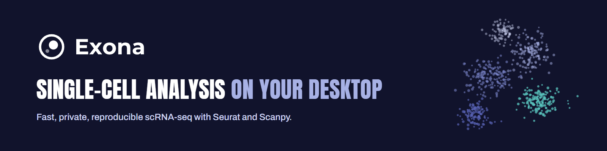

  

<h1 align="center">Exona</h1>

  <strong>Computational biology, accessible to every scientist.</strong> 
  A desktop app for single-cell RNA-seq analysis, built for the whole lab.

  <a href="https://exona.bio">exona.bio</a>

---

Single-cell RNA-seq has changed biology, but the analysis still lives in R and Python scripts that many wet-lab
researchers can't run on their own. Exona puts a modern desktop interface on top of the standard tools
(**Seurat**, **Scanpy**) so biologists can explore their data without a terminal, and bioinformaticians keep full
transparency and standard, interoperable objects.

- **Zero setup.** Runs on Windows, macOS and Linux with an isolated, managed R/Python runtime. No environment conflicts.
- **Traceable by default.** Every run records its parameters, seeds, package versions and input checksums, so an
  analysis can be repeated and described in a paper's Methods.
- **Publication-ready figures.** High-resolution PDF/PNG plots, straight from the app.
- **Open formats.** Each project is a plain folder with standard Seurat `.rds` objects you can open in your own scripts.
- **Your data stays local.** Analyses run on your machine, with plugins to offload heavy compute to a cluster.

## Repositories

| Repository | What it is | Stack |
| :--- | :--- | :--- |
| [**exona**](https://github.com/exona-bio/exona) | The Exona desktop app: UI, R and Python compute engines, installers | Electron · React · TypeScript · Fluent UI · R (Seurat, plumber) · Python (FastAPI) |
| [**exona-web**](https://github.com/exona-bio/exona-web) | [exona.bio](https://exona.bio): marketing site, licensing API, customer portal and back office | Next.js · TypeScript · Supabase (Postgres) |

## Status

Exona is in early development. Cell-type annotation and more downstream analyses are on the way.

Interested in trying Exona in your lab, or in a collaboration? Get in touch through [exona.bio](https://exona.bio).
