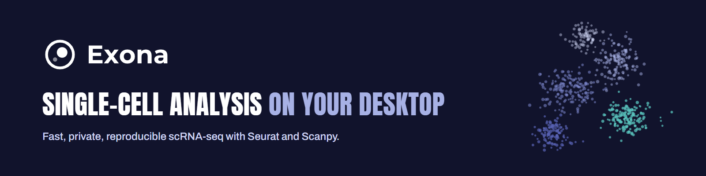
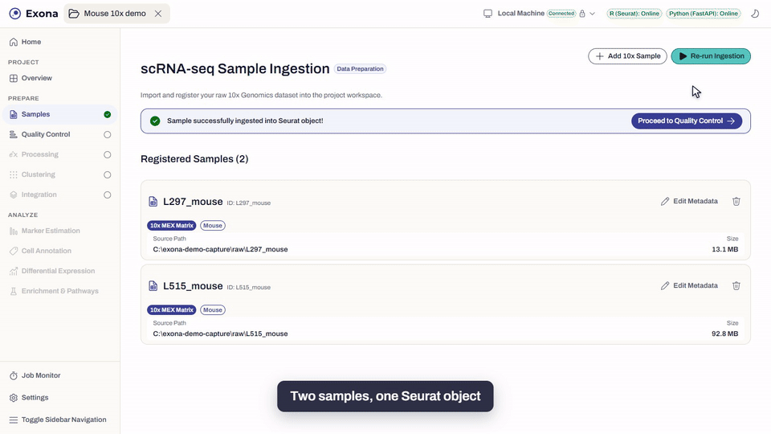
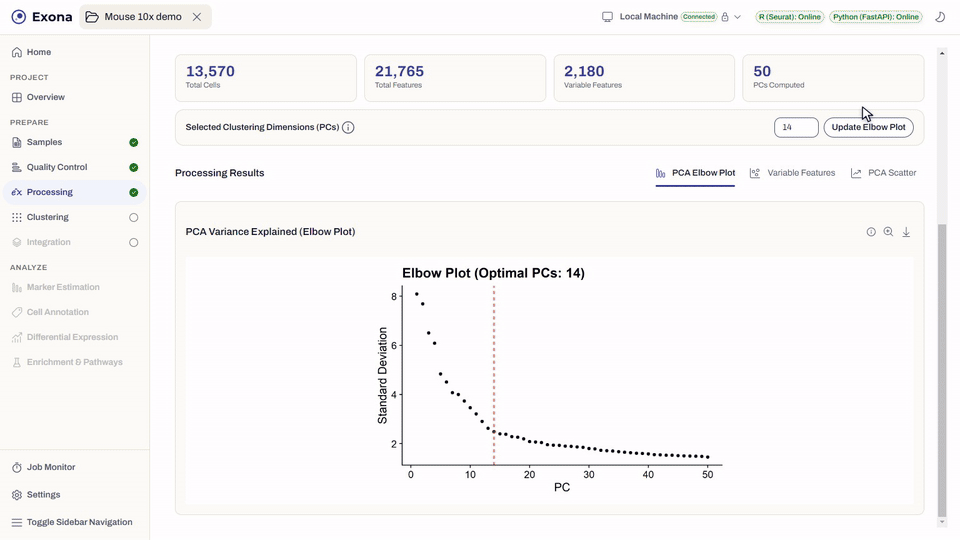
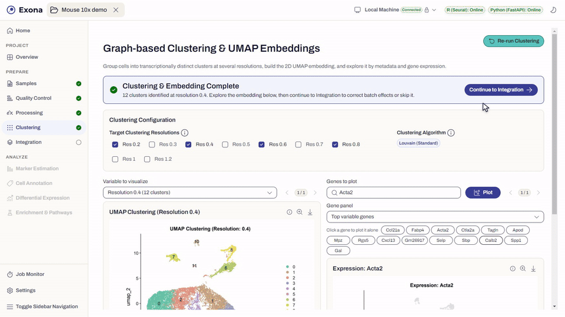

  

<h1 align="center">Computational biology, accessible to every scientist.</h1>
 

  Exona guides researchers through their own single-cell data, step by step, with no code and no setup.

  <a href="https://exona.bio"><b>exona.bio</b></a> ·
  <a href="https://exona.bio/platform">Platform</a> ·
  <a href="https://exona.bio/consulting">Consulting</a> ·
  <a href="https://exona.bio/about">About us</a> ·
  <a href="https://exona.bio/contact">Request a demo</a>

 
## Why Exona
 
In most labs, researchers wait in the bioinformatician's queue to look at their own data, and bioinformaticians
lose hours on small, repeated requests. Steps get lost between scripts, people and projects, and the lab's know-how
leaves when people do.
 
We think a lab should be able to do four things with its own data:
 
| | |
| :--- | :--- |
| 🔍 **Explore** | Every scientist can work with their own data. |
| ✅ **Trust** | Every result can be traced, understood and reproduced. |
| 🤝 **Share** | What one scientist does, the whole lab can build on. |
| 🌱 **Grow** | A lab's knowledge stays, accumulates and is there when it's needed. |
 
## What Exona does today
 
A desktop app that takes a researcher from 10x Genomics output to clusters and marker genes, and keeps a record of
every step.
 
- **Guided analysis.** No code, no setup. Each step explains what it does and suggests cut-offs you can adjust.
- **Runs where your data lives.** Laptop, server or HPC cluster. Compute plugins run the analysis there, so the data
  never has to move and nothing is uploaded to us.
- **Recorded automatically.** Data, tools, versions and parameters are stored for every step, ready to become
  Methods text and figures.
<table>
  <tr>
    <td width="33%" valign="top">
      
       <b>Quality control with suggested cut-offs</b> Before and after filtering, side by side.
    </td>
    <td width="33%" valign="top">
      
       <b>Clusters and gene expression</b> Pick a resolution, pick a gene, see it on the UMAP.
    </td>
    <td width="33%" valign="top">
      
       <b>Batch correction with Harmony</b> Both samples on one integrated UMAP, ready to explore.
    </td>
  </tr>
</table>
Recorded in the real app on two public mouse 10x samples, about 13,600 cells after quality control.
Computation is sped up and labelled on screen.
 
### The analysis
 
**Available now:** Samples → Quality control → Processing → Clustering & UMAP → Integration → Marker genes
 
**Next:** Cell annotation · Differential expression · Enrichment & pathways
 
**Later:** bulk, spatial and other omics.
 
## Built for teams with or without bioinformaticians
 
- **Teams without a bioinformatician.** Wet-lab researchers analyse their own single-cell RNA-seq data, from 10x
  Genomics output to clusters and marker genes, without writing code. When a project needs more, our consultants
  work with you.
- **Teams with bioinformaticians.** Biologists run routine analyses themselves, so your bioinformaticians can focus
  on new methods. Custom compute plugins run Exona's analyses on your own cluster or HPC, following your IT rules.
## Where we're going
 
- **A shared workspace.** Colleagues open, reuse and build on each other's analyses instead of starting again.
- **The lab's memory.** Pipelines, parameters, decisions, annotations, markers and papers, captured as people work,
  searchable and askable.
## Consulting
 
For the questions an app can't answer yet, our scientists advise on experimental design and run custom analyses,
then hand the result over inside Exona, with the code and the full record, so the lab keeps it.
[More on consulting →](https://exona.bio/consulting)
 
## How we work
 
- **Your data stays where it is.** Exona runs on your laptop, server or cluster.
- **Every step is on the record.** If a result can't be traced and reproduced, we don't consider it finished.
- **Scientists first.** We build with researchers in the room, and our consultants are scientists too.
---
 

  <b>See Exona on your own data.</b> 
  Book a live demo with our team, on a public dataset or on yours: <a href="https://exona.bio/contact">exona.bio/contact</a>

